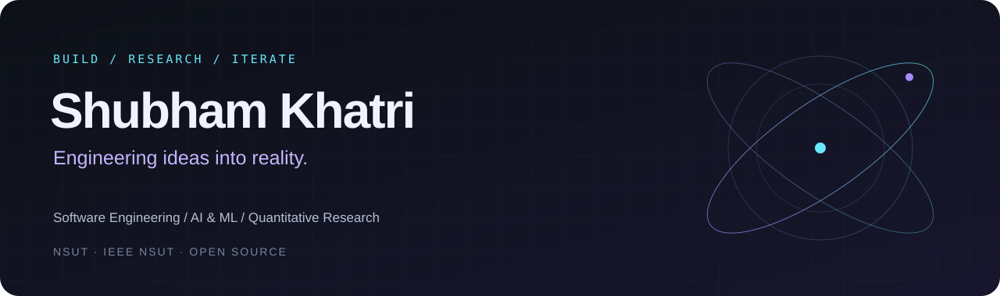

  

  
  
  

  
  
  

  <a href="#about">About</a> &nbsp; / &nbsp;
  <a href="#selected-work">Selected work</a> &nbsp; / &nbsp;
  <a href="#toolbox">Toolbox</a> &nbsp; / &nbsp;
  <a href="#github-observatory">GitHub observatory</a>

## About

I'm **Shubham**, an Instrumentation & Control Engineering student at **Netaji Subhas University of Technology (NSUT)** and **Tech Head at IEEE NSUT**. I work at the intersection of engineering, mathematics, and computation — building useful software and exploring the ideas behind intelligent systems.

- **Building:** AI applications, retrieval pipelines, and full-stack experiences.
- **Studying:** machine learning, algorithms, distributed systems, and statistical modeling.
- **Exploring:** systematic research, time series, factor models, and portfolio construction.
- **Contributing:** technical initiatives, workshops, and student-focused activities at IEEE NSUT.

> Understand deeply. Build deliberately. Measure objectively. Iterate relentlessly.

## Selected work

<table>
<tr>
<td width="50%" valign="top">
<h3>01 / FluentIQ</h3>

<strong>Answers grounded in your documents.</strong>

A retrieval-augmented AI assistant combining semantic search, vector embeddings, and contextual generation in an end-to-end RAG pipeline.

<code>Python</code> <code>Streamlit</code> <code>Gemini</code> <code>LangChain</code> <code>FAISS</code>

<a href="https://github.com/Shubh3155/Fluentiq">Explore the repository ↗</a>

</td>
<td width="50%" valign="top">
<h3>02 / NSUT One</h3>

<strong>One workspace for student life.</strong>

An independent dashboard bringing notices, attendance, timetables, courses, results, and admit cards together, with optional IMS account connectivity.

<code>Student tools</code> <code>Dashboard</code> <code>IMS integration</code>

<a href="https://nsutone.vercel.app/">Visit NSUT One ↗</a>

</td>
</tr>
<tr>
<td width="50%" valign="top">
<h3>03 / Formula 1 Predictor</h3>

<strong>Racing data meets predictive modeling.</strong>

Exploring Formula 1 outcome prediction with historical data, feature engineering, ensemble methods, and model blending.

<code>Machine learning</code> <code>Feature engineering</code> <code>Model evaluation</code>

</td>
<td width="50%" valign="top">
<h3>04 / Electify India</h3>

<strong>An interactive look at a national idea.</strong>

A full-stack platform exploring One Nation One Election through a responsive web experience and supporting backend services.

<code>Next.js</code> <code>React</code> <code>Node.js</code> <code>MongoDB</code> <code>Vercel</code>

</td>
</tr>
</table>

## Toolbox

**Languages**

**AI & machine learning**

`NumPy` · `Pandas` · `XGBoost` · `LightGBM` · `LangChain` · `FAISS` · `Hugging Face`

**Web & applications**

**Data & infrastructure**

`SQL` · `REST APIs` · `Vector search` · `Embeddings` · `RAG pipelines`

## GitHub observatory

A living snapshot of the code, contributions, and consistency behind the projects.

  
  

  

  

<strong>Explore more · contribution history, language breakdowns & coding hours</strong>

 

  

  
  

  
  

<strong>Trophy cabinet · community-generated milestones</strong>

 

  

<strong>Project pulse · FluentIQ repository stats</strong>

 

  

  
  
  
  
  

<!-- SNAKE:START -->
<!-- The included workflow adds the contribution animation here after its first successful run. -->
<!-- SNAKE:END -->

Cards reflect the data available to each provider and may refresh at different times. Language distribution describes repository code, not proficiency; commit timing is not time spent coding.

## Research notebook

I'm exploring how mathematical and statistical methods can uncover robust signals in financial data, with a focus on understanding the foundations behind systematic strategies.

| Research direction | Questions I'm exploring |
| :--- | :--- |
| **Signals & factors** | What makes a signal robust across changing market conditions? |
| **Time series & ML** | How can models capture structure without overfitting noise? |
| **Portfolios & risk** | How do signals translate into balanced, measurable strategies? |
| **Engineering** | How can research become reproducible, maintainable software? |

Outside of code, I'm drawn to financial markets, engineering systems, and problems with no obvious solution.

---

  <strong>Have an interesting problem? Let's build something thoughtful.</strong>  
  <a href="mailto:Shubham.khatri.ug24@nsut.ac.in">Say hello</a> &nbsp; · &nbsp;
  <a href="https://shubhuniverse.vercel.app/">Explore my universe</a> &nbsp; · &nbsp;
  <a href="https://github.com/Shubh3155?tab=repositories">Browse my repositories</a>

